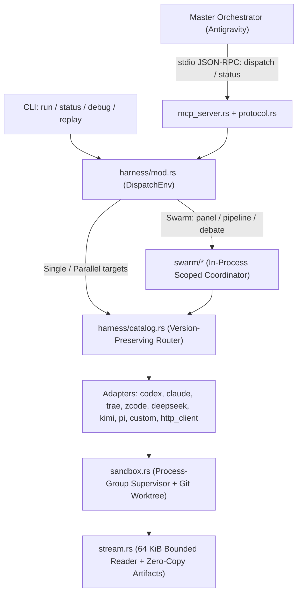

# External Model Subagents v3.0 — Architecture Guide

## Design Philosophy
`ext-models-mcp` is a single pure-`std` Rust binary (`< 700 KB` stripped release, `~2 MB` idle RSS, `0.0%` idle CPU) acting as a Master–Worker MCP Hub for external AI coding CLIs and declarative HTTP model endpoints.

## Module Map

| Module | Responsibility |
| :--- | :--- |
| `src/alloc_cap.rs` | `#[global_allocator]` wrapper enforcing hard `EXT_MODELS_MAX_HEAP_MB` (`4..=256 MiB`) and 70% soft-limit shedding. |
| `src/error.rs` | Flat `RichError` (`6` `ErrorKind` variants) with actionable suggestions and `<call_id>-panic.log` persistence. |
| `src/mcp_server.rs` & `src/protocol.rs` | Bounded JSON-RPC 2.0 loop, `5s` semantic `ProgressState` notifications, and 2-tool schema (`dispatch` + `status`). |
| `src/sandbox.rs` | Cross-platform (`#[cfg(unix)]` / `#[cfg(not(unix))]`) process-group supervision, `JobPermit` concurrency semaphore, and RAII `Drop`-guarded dirty-aware `WorktreeSession`. |
| `src/stream.rs` | `O(1)` UTF-8 safe `read_bounded_line`, owner-only `0o600` + `O_NOFOLLOW` artifacts, zero-copy `read_handoff`, and once-per-process TTL cleanup (`EXT_MODELS_ARTIFACT_TTL_DAYS`). |
| `src/swarm/*` | In-process `Panel` (`thread::scope` + weighted `ConsensusEngine`), `Pipeline` (`SwarmContext` single-pass templates + output validators), and `Debate` (`Proposer` vs `Challenger` + `Judge`). |
| `src/harness/*` | Orthogonal 4-stage `HarnessAdapter` pipeline (`build_base` -> `headless_guard` -> `project_rules` -> `capabilities`), strict version-preserving router, and zero-exposure `curl -K -` streaming `HttpHarnessAdapter`. |
| `src/observability.rs`, `src/metrics.rs`, `src/debug_cli.rs` | Opt-in structured event logging, zero-allocation `AtomicU64` counters + 5-bucket latency histogram, and secret-safe `debug` / `trace` / `replay` commands. |

## Core Invariants
1. **Zero Heavy Dependencies**: Only `serde_json` + `#[cfg(unix)] libc`. No async runtime, no Rust TLS stack, no lock-free hash-table bloat.
2. **Parse Once at Ingress**: JSON schemas, CLI flags, and config files are validated and clamped once at the boundary; internal modules operate on trusted types without redundant defensive checks.
3. **Zero Credential Leakage**: Catalog scanners never read secret values; HTTP adapters pass headers via `curl -K -` stdin and strip `api_key_env` from child environments.
